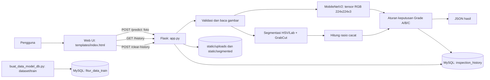

# Blueprint TobaccoVision

## 1. Ringkasan

TobaccoVision adalah aplikasi web untuk membantu inspeksi mutu daun tembakau di Desa Ambat. Pengguna mengunggah foto daun, melihat segmentasi dan klasifikasi mutu, menerima rekomendasi penanganan, serta meninjau riwayat inspeksi.

Blueprint ini mendokumentasikan perilaku yang sudah ada dan memisahkan rekomendasi pengembangan dari implementasi saat ini.

## 2. Tujuan dan Pengguna

**Tujuan utama:** memberi pemeriksa alat bantu visual yang konsisten untuk mengelompokkan daun ke Grade A (siap rajang), Grade B (sortir parsial), atau Grade C (afkir total).

**Pengguna utama:** operator atau pemeriksa daun tembakau. Sistem memberi rekomendasi operasional; keputusan akhir tetap pada pemeriksa.

## 3. Fitur

- Unggah foto daun dari browser dan tampilkan pratinjau.
- Segmentasikan daun menggunakan pemrosesan warna HSV/Lab, GrabCut, dan kontur utama.
- Hitung rasio piksel cacat pada area daun.
- Klasifikasikan foto daun menggunakan model MobileNetV2.
- Sajikan grade, ringkasan, confidence, distribusi kelas, gambar hasil segmentasi, dan rekomendasi.
- Simpan inspeksi ke MySQL XAMPP dan tampilkan hingga 50 catatan terbaru dengan filter grade.
- Kosongkan seluruh riwayat inspeksi.

## 4. Arsitektur Saat Ini

**Komponen dan tanggung jawab:**

| Komponen | Tanggung jawab |
| --- | --- |
| `templates/index.html` | UI satu halaman: unggah, hasil, riwayat, filter grade, dan pemanggilan API. |
| `app.py` | Route Flask, pemrosesan citra, aturan grade, penyimpanan gambar, dan akses MySQL. |
| `fitur_tembakau.py` | Ekstraksi fitur numerik HSV dan normalisasi nama kelas yang dipakai bersama saat impor data dan prediksi. |
| `buat_data_model_db.py` | Mengekstrak fitur gambar di `dataset/train/` dan menyimpannya secara idempoten ke tabel MySQL `fitur_data_train`. |
| `train_mobilenet.py` | Melatih model klasifikasi MobileNetV2 dari citra di folder dataset. |
| `model/` | Artefak MobileNetV2 modern `mobilenet_tembakau.keras`, dilatih memakai segmentasi dan crop yang sama dengan prediksi. |
| `dataset/train/`, `dataset/test/` | Dataset berlabel untuk pelatihan dan evaluasi. Kelas yang diharapkan: `afkir_total`, `siap_rajang`, `sortir_parsial`. |
| `static/uploads/` | Foto asli hasil unggahan. |
| `static/segmented/` | Citra terisolasi yang dibuat selama inspeksi. |
| `database.py` | Konfigurasi dan koneksi bersama ke MySQL XAMPP (`db_tembakau_ambat`). |

## 5. Alur Inspeksi

1. Pengguna memilih foto pada halaman **Uji Daun**.
2. Browser mengirim multipart form dengan field `file` ke `POST /predict`.
3. Backend memastikan model tersedia, menyimpan foto, membaca citra, lalu mengubah ukurannya menjadi 224 x 224.
4. Segmentasi HSV/Lab dan GrabCut mencari kontur daun terbesar, membuat PNG dengan alpha transparan, dan menghitung persentase cacat pada area daun.
5. Backend memotong daun, memberi padding hitam dengan rasio aspek terjaga, lalu mengirim tensor RGB 224 x 224 x 3 ke MobileNetV2. Model dilatih dengan preprocessing yang sama.
6. Backend menggabungkan kelas model dan rasio cacat untuk menentukan grade serta rekomendasi; rasio cacat tinggi tanpa prediksi kelas afkir tidak otomatis menolak daun.
7. Backend menyimpan ringkasan inspeksi ke MySQL lalu mengembalikan hasil beserta URL foto asli dan hasil segmentasi.
8. Browser menampilkan perbandingan gambar, hasil klasifikasi, rekomendasi, dan distribusi kelas. Riwayat dimuat saat tab **Riwayat** dibuka.

## 6. Aturan Klasifikasi Saat Ini

Urutan keluaran model: `afkir_total`, `siap_rajang`, `sortir_parsial`.

| Hasil | Kondisi saat ini | Rekomendasi utama |
| --- | --- | --- |
| Grade C | Kelas terpilih `afkir_total` **atau** cacat >= 25% | Afkir total dan pisahkan dari bahan rajangan. |
| Grade A | Kelas terpilih `siap_rajang` dan cacat < 12% | Siap digulung dan dimasukkan ke mesin perajang. |
| Grade B | Semua kondisi lainnya | Sortir/rompes bagian cacat sebelum dirajang. |

## 7. API Saat Ini

| Method dan path | Fungsi | Respons utama |
| --- | --- | --- |
| `GET /` | Menampilkan halaman aplikasi. | HTML. |
| `POST /predict` | Menerima foto pada field `file`, memproses citra, menyimpan ringkasan inspeksi. | JSON `status` dan `data` yang memuat grade, confidence, cacat, probabilitas tampilan, rekomendasi, serta URL gambar. |
| `GET /history` | Mengambil maksimal 50 inspeksi terbaru. | JSON `status` dan array `history`. |
| `POST /clear-history` | Menghapus seluruh baris riwayat. | JSON `status` dan pesan. |

**Kondisi/error yang telah ditangani:** `/predict` mengembalikan 500 saat model belum siap, 400 saat foto gagal dibaca, dan 503 saat riwayat inspeksi tidak dapat disimpan ke MySQL. Route riwayat mengembalikan 503 jika MySQL tidak tersedia.

## 8. Data Riwayat

Tabel `inspection_history` dibuat otomatis ketika aplikasi mulai.

| Kolom | Makna |
| --- | --- |
| `id` | ID otomatis inspeksi. |
| `filename` | Nama berkas foto tersimpan. |
| `grade` | Huruf grade: `A`, `B`, atau `C`. |
| `confidence` | Nilai confidence yang dikirim ke antarmuka. |
| `defect_percentage` | Rasio cacat hasil segmentasi dalam persen. |
| `recommendation` | Tindakan yang disarankan. |
| `action_step` | Catatan penanganan lanjutan. |
| `created_at` | Waktu pencatatan, default MySQL `CURRENT_TIMESTAMP`. |

## 9. Pelatihan Model

`buat_data_model_db.py` membaca hanya gambar pada `dataset/train/`, mengekstrak luas daun, luas/rasio cacat, serta nilai rata-rata HSV, lalu menyimpan setiap sampel beserta label dan jalur sumber ke tabel `fitur_data_train` di database MySQL `db_tembakau_ambat`. Penulisan bersifat idempoten: menjalankannya ulang memperbarui sampel yang sama, bukan menggandakan baris. Gambar di folder test tidak dimasukkan ke data training.

`train_mobilenet.py` membaca citra dan label dari folder dataset, melatih MobileNetV2, dan menyimpan model ke folder `model/`. Saat inferensi, backend mengirim tensor citra RGB berukuran 224 x 224 x 3 ke model.

Nama dan urutan kelas dataset diverifikasi terhadap urutan yang dipakai aplikasi. Perubahan label kelas harus diselaraskan pada script training dan `CLASS_NAMES` di aplikasi.

## 10. Batasan dan Risiko yang Diketahui

- **Fitur untuk model dihitung dari citra yang diunggah.** Model menerima enam nilai numerik hasil ekstraksi HSV, sedangkan segmentasi GrabCut yang ditampilkan dipakai untuk menghitung rasio cacat operasional. Hasil model belum menggunakan masker segmentasi sebagai dasar ekstraksi fiturnya.
- **Confidence dan probabilitas yang ditampilkan bukan skor mentah model.** Backend menerapkan rumus confidence berdasarkan grade dan rasio cacat, lalu membagi ulang probabilitas agar grade pemenang mendominasi. Hindari menafsirkannya sebagai probabilitas terkalibrasi.
- **Validasi unggahan perlu diperkuat.** Saat ini belum tampak batas ukuran, allowlist format yang eksplisit, atau penanganan khusus untuk gambar rusak/terlalu besar sebelum decoding.
- **Operasi hapus riwayat tidak memiliki autentikasi/otorisasi.** Jangan mengekspos aplikasi ke jaringan publik tanpa kontrol akses dan perlindungan request yang sesuai.
- **Berkas unggahan dan hasil segmentasi tidak dibersihkan otomatis.** Pertumbuhan penyimpanan perlu dipantau dan kebijakan retensi ditentukan.
- **Kegagalan simpan riwayat tidak menggagalkan respons prediksi.** Hasil bisa ditampilkan tanpa tercatat di database.
- **Resize langsung ke persegi dapat mengubah rasio aspek foto.** Periksa apakah letterbox/crop yang konsisten lebih sesuai untuk inferensi dan evaluasi.
- Dataset dan artefak model tidak tercantum dalam `requirements.txt`; dataset perlu disediakan, kemudian database fitur dan artefak model dapat dibangun dengan script proyek.

## 11. Rekomendasi Pengembangan

Prioritas berikut disarankan untuk tahap berikutnya, bukan klaim bahwa fitur tersebut sudah tersedia:

1. Evaluasi kualitas model fitur tabular pada dataset tambahan yang representatif sebelum dipakai sebagai dasar keputusan operasional.
2. Pisahkan skor mentah model, aturan grade, dan confidence operasional di respons API. Kalibrasikan confidence sebelum ditafsirkan sebagai peluang benar.
3. Tambahkan validasi ukuran dan tipe file, respons error yang aman, serta batas waktu/kapasitas pemrosesan.
4. Tambahkan konfirmasi dan otorisasi untuk penghapusan riwayat, serta kebijakan retensi berkas.
5. Tambahkan pengujian unit untuk ambang grade, segmentasi pada sampel representatif, validasi API, dan integrasi database.
6. Catat versi model dan metadata preprocessing pada hasil inspeksi agar hasil bisa diaudit setelah model diperbarui.

## 12. Cara Menjalankan

1. Instal dependensi dari `requirements.txt` pada environment Python yang sesuai.
2. Pastikan `dataset/train/` memiliki tiga folder kelas yang benar. Jalankan `python buat_data_model_db.py`, kemudian `python train_mobilenet.py` untuk membangun database fitur dan model.
3. Jalankan `python app.py` dan buka `http://127.0.0.1:5000`.

Server pengembangan saat ini bind ke `0.0.0.0:5000` dengan `debug=False`. Untuk deployment, gunakan WSGI server seperti Waitress (sudah tercantum pada dependensi) dan konfigurasi deployment yang sesuai lingkungan.